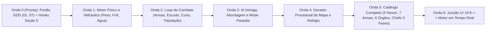

# PASSO 7: Plano Mestre de Engenharia de Testes e Portões de Avanço (As 14 Leis Aplicadas ao Projeto)

Este documento planeja **100% da arquitetura de testes antes de codar o jogo**. O objetivo é garantir que cada passo da futura implementação seja governado pelas **14 Leis (`L1–L7` e `N1–N7`)** e pela **Seção 5 (Blindagem de Hooks/Worktrees)**, servindo como um trilho de avanço onde nenhuma frente pode avançar com "verde falso".

---

## 7.1. Tradução das 14 Leis para o Domínio do *Bio-Foil*

Nenhuma lei fica abstrata. Abaixo está como cada lei proíbe armadilhas específicas quando formos codar o jogo:

| Lei | Regra no Papel | O que ela PROÍBE no código do *Bio-Foil* | Como o teste é obrigado a medir |
| :---: | :--- | :--- | :--- |
| **L1** | A camada que mocka a peça não vê a peça quebrar | Proibido mockar `calcularSustentacao`, `avancarTickAgua` ou `resolverDisparo` ao testar o loop de combate ou a UI. | O teste chama o loop real de combate com os módulos reais de física, hidráulica e armas acoplados. |
| **L2** | O fixture mais generoso que a peça | Proibido reutilizar o mesmo objeto `estadoNave` entre ticks fazendo `camara.aguaKg -= 1.0` in-place no teste. | Cada `tick(estadoAnterior, dt)` recebe um estado congelado (`Object.freeze`) e devolve um **novo** estado; o teste falha se o estado anterior for mutado. |
| **L3** | Zero por ausência $\neq$ zero por cálculo | Proibido `lerSalaInimiga()` devolver `[]` ou `0` tanto para **"sala vazia"** quanto para **"sala cega por Águas Turvas / Bolsa de Tinta"**. | Retorno obrigatório em 2 canais: `{ visibilidadeSonar: 'VISIVEL' \| 'CEGO_AGUAS_TURVAS' \| 'CEGO_TINTA', tripulantes: [...] }`. |
| **L4** | A asserção que compara a peça consigo mesma | Proibido escrever `expect(peso).toBe(PESO_CHASSI + 8 * CAP_AGUA)` importando as constantes do próprio módulo. | O teste asserta o valor literal canônico (`225`, `260`, `480`, `6.75`, `32.75`) extraído independentemente da Tabela SSOT (Passo 6). |
| **L5** | Portão de estado final com cadeia parcial | Proibido testar "todas as naves" carregando só 2 naves num array manual dentro do teste. | O portão carrega a cadeia completa (`8 câmaras`, `7 armas`, `6 órgãos`, `8 biomas`, `5 naves`, `3 fases do chefe`) + *tripwire* que compara com os arquivos/chaves do diretório. |
| **L6** | Vermelho pela razão errada | Proibido validar um teste passando `null` ou string inválida que dá `TypeError` de sintaxe/forma. | Toda mutação altera uma **regra matemática** (ex.: trocar `-25%` de resfriamento em *Touchdown* por `0%`) e registra a 1ª linha de falha real em `MUTACOES.md`. |
| **L7** | Relato de passada não é medição | Proibido declarar "testei na tela e funcionou" ou consertar bug sem antes inspecionar o dump de estado/log do tick. | Log determinístico do estado do tick (`t`, `pesoTotal`, `sustentacao`, `aguaPorSala`) primeiro; UI depois. |
| **N1** | Junção roda os dois lados | Proibido testar `Mapa` separado de `Nave`, ou `UI` separada do `Motor de Combate`. | Todo teste de fronteira roda produtor + consumidor reais juntos (ex.: dano no Mastro no combate $\rightarrow$ queda para *Touchdown* $\rightarrow$ bloqueio da Válvula na UI). |
| **N2** | Lista-catraca | Proibido comentar teste quebrado (`test.skip`) ou consertar código de outra frente no meio de uma onda de teste. | Defeitos abertos entram em `LISTA_CATRACA` com `{ id, data, frase }`. Se passar a verde sem sair da lista, o portão fica vermelho. |
| **N3** | "Declarado" tem motivo e data | Proibido tornar um portão novo obrigatório na `main` na primeira execução verde. | Exige **3 corridas verdes consecutivas na `main`** com a saída completa colada no relatório da onda. |
| **N4** | Quem enumera diz quantos examinou | Proibido `for (const arma of armas)` que passa em branco quando `armas` está vazio (`[]`). | Todo teste enumerador imprime `[N4] Examinados: N` e tem `assert(N > 0)` + `assert.equal(N, esperado)`. |
| **N5** | Trabalho paralelo em Worktree | Proibido codar direto no checkout vivo (`/Users/dudujarra/Documents/ftl`). | Cada onda abre uma worktree irmã (`git worktree add`), verifica `uptime < 20` e nunca usa `--no-verify` ou `--force`. |
| **N6** | Onda de teste não conserta produto | Proibido misturar commit de criação de portão de teste com commit de feature/conserto de produto. | Sessão de teste apenas cria/audita o teste e alimenta a catraca; sessão de produto apenas implementa/conserta até esvaziar a catraca. |
| **N7** | O vivo não é a `main` | Proibido relatar status sem informar o hash do commit e a distância até a `main`. | Todo relatório traz `git rev-parse --short HEAD` e `git rev-list --count HEAD..main`. |

---

## 7.2. O Mapa das 6 Ondas de Implementação e seus Portões de Avanço

Quando começarmos a codar, o projeto avançará em **6 Ondas Sequenciais**. Uma Onda **só é considerada concluída** quando seu Portão de Testes sobreviver a todas as mutações semânticas listadas abaixo e passar por 3 corridas verdes seguidas na `main` (**N3**).

---

### ONDA 1: Motor Físico, Hidráulico e Estados da Nave (*No Foil*, *Touchdown*, *Spool-up*)
* **O que será codado nesta onda:** Equações de `PesoTotal`, `SustentacaoAtual`, `Cavitacao (< 62.5 kg)`, transição automática *No Foil* $\leftrightarrow$ *Touchdown*, timer de `Spool-up (3.0s)`, taxas de água (`-1.0 kg/s` furo no ar, `-2.5 kg/s` válvula no ar, `+5.0 kg/s` alagamento/recarga no mar, `+1.25 kg/s` capilar no ar, `-4.0 kg/s` dreno de alagamento pesado) e travamento de vazamento pelo *Baiacu Inflado* (`0.0 kg/s`).
* **Junção Obrigatória (`N1`):** `Hidráulica das 8 Câmaras` $\leftrightarrow$ `Física de Voo do Hidrofólio` (esvaziar 4 salas no ar reduz o peso em `-50 kg`, mas aciona cavitação abaixo de `62.5 kg` tirando `-25 kg` de sustentação no mesmo tick!).
* **Contadores Obrigatórios (`N4`):** `8` câmaras examinadas por tick, `5` estados físicos da nave, `7` patamares de barras do Mastro (`1..7` barras $\rightarrow 50..330\text{ kg}$).
* **Mutações que o teste da Onda 1 é obrigado a pegar (`L6`):**
  1. `MUT-O1-01`: Remover a regra de queda para $0\text{ kg}$ quando `barrasSifao === 0` (deixar o Mastro sustentar sozinho parado) $\rightarrow$ **DEVE FICAR VERMELHO** no teste de *Touchdown* por perda de propulsão.
  2. `MUT-O1-02`: Permitir abrir Válvula Externa (Airlock) quando o estado é `TOUCHDOWN` ou `SPOOL_UP` $\rightarrow$ **DEVE FICAR VERMELHO** na célula `2C / 3C` da Matriz.
  3. `MUT-O1-03`: Não zerar o progresso do `Spool-up (3.0s)` se um alagamento pesado fizer $P_{\text{total}} > S_{\text{atual}}$ em $t = 2.5\text{s}$ $\rightarrow$ **DEVE FICAR VERMELHO** na célula `3B` da Matriz.
  4. `MUT-O1-04`: Esquecer a cavitação de `-2 kg` por `1 kg` abaixo de `62.5 kg` de água $\rightarrow$ **DEVE FICAR VERMELHO** ao drenar a 4ª câmara.

---

### ONDA 2: Loop de Combate, Armas, Barreira, Curto-Circuito e Tripulação
* **O que será codado nesta onda:** Recarga de armas (com bônus aditivo de operador `-10% / -20%` e resfriamento de *Touchdown* `-25%`, piso `50%`), regeneração da Glândula de Barreira (`2.0s / 1.7s / 1.5s`), Oxigênio da Bomba Branquial (`-4%/s` desligada, asfixia `< 20%`, cura local `+5/+12/+18 HP/s` e `Pulso de Enzimas` sem acumular na própria sala), Curto-Circuito (`-4 HP/s`, `1 barra/8s`, extinção em `3s` a `0%` água) e movimentação/reparo dos 4 arquétipos de tripulação.
* **Junção Obrigatória (`N1`):** Reprodução exata, tick a tick ($dt = 0.25\text{s}$), da **Simulação Cronometrada do Passo 3 ($t = 0.0\text{s}$ a $t = 32.75\text{s}$)**! O teste alimenta os comandos do jogador e verifica que cada evento ocorre no exato décimo de segundo provado no GDD (`t=9.0s`, `11.0s`, `13.0s`, `14.25s`, `16.75s`, `19.75s`, `20.25s`, `23.50s`, `25.50s`, `29.75s`, `30.25s`, `32.75s`).
* **Canal de Permissão/Visibilidade (`L3`):** Sensor de salas inimigas deve separar `SALA_VAZIA` de `CEGO_AGUAS_TURVAS` e `CEGO_BOLSA_TINTA`.
* **Contadores Obrigatórios (`N4`):** `4` arquétipos de tripulantes examinados, `12` marcos temporais da simulação do Passo 3 verificados.
* **Mutações que o teste da Onda 2 é obrigado a pegar (`L6`):**
  1. `MUT-O2-01`: Multiplicar `(1 - 0.20) * (1 - 0.25)` em vez de somar aditivamente `1 - 0.20 - 0.25` na recarga de armas (Hierarquia Nível 3) $\rightarrow$ **DEVE FICAR VERMELHO**.
  2. `MUT-O2-02`: Permitir que a *Glândula de Tinta Furtiva* dê `+60%` de esquiva contra tiros em voo enquanto a nave está em `TOUCHDOWN` (violando a Hierarquia Nível 2 sobre Nível 3) $\rightarrow$ **DEVE FICAR VERMELHO**.
  3. `MUT-O2-03`: Somar os `+5 HP/s` do *Pulso de Enzimas* em cima dos `+18 HP/s` dentro da própria Bomba Branquial (`23 HP/s`, tornando o tripulante imortal contra 2 Mergulhadores de Assalto de `24 DPS`) $\rightarrow$ **DEVE FICAR VERMELHO** na prova *Anti-Immortality* (Seção 6.3).
  4. `MUT-O2-04`: Não aplicar `-50%` na velocidade de reparo de Polvo/Arraia/Baiacu em sala `0%` seca $\rightarrow$ **DEVE FICAR VERMELHO**.

---

### ONDA 3: IA Inimiga (Barcos Humanos vs. Monstros), Abordagem e Condições de Vitória
* **O que será codado nesta onda:** IA de marinheiros humanos (prioridade de consertar Bomba de Porão e fugir de salas inundadas), IA de Monstros Marinhos (órgãos inundados, anticorpos/tentáculos), *Tubo Pressurizado* (injeção de `15 kg` de água em barcos ou *Modo Parasita* em monstros, regra de via única sem retorno até o Atracar), e as **3 Condições de Vitória** (Destruição Bruta, Asfixia/Inundação de Barco, Extração de Órgão por Bio-Choque).
* **Junção Obrigatória (`N1`):** `Disparo do Tubo Pressurizado / Arpão` $\leftrightarrow$ `Alagamento Interno do Barco Inimigo` $\leftrightarrow$ `Tabela de Saque (Sucata / Biomassa / Órgão Intacto)`.
* **Contadores Obrigatórios (`N4`):** `2` classes de inimigos (Metal vs. Carne), `3` condições de vitória e respectivas tabelas de recompensa examinadas.
* **Mutações que o teste da Onda 3 é obrigado a pegar (`L6`):**
  1. `MUT-O3-01`: Permitir que uma arma sem munição (ex.: *Canhão de Arpão*) atravesse 1 camada ativa de Barreira $\rightarrow$ **DEVE FICAR VERMELHO**.
  2. `MUT-O3-02`: Matar o animal aliado por "explosão da nave" quando o casco inimigo zera por **Sabotagem Interna** (violando a regra de *Naufrágio Controlado* da Contra-Auditoria #5) $\rightarrow$ **DEVE FICAR VERMELHO**.
  3. `MUT-O3-03`: Permitir recolher animal invasor no meio da luta ou mantê-lo vivo se o jogador clicar em **Fugir** $\rightarrow$ **DEVE FICAR VERMELHO**.

---

### ONDA 4: Gerador Procedural de Mapa (18 a 22 Nós) e Relógio da Corporação
* **O que será codado nesta onda:** Amostragem *Poisson Disc* em 6 colunas (`0` a `5`), triangulação de rotas ($\le 28\text{ MN}$, zero becos sem saída à direita), sorteio de correntes (`60%` normal `1.0x`, `20%` favorável `0.75x`, `20%` mar revolto `1.35x`), baralho invariante de nós (2 Lojas nas colunas 2–4, 4 SOS, 3 Perigos Ambientais), nivelamento automático de tanques em `100 kg` antes de viajar, equação de velocidade com teto de `15.0 MN/h`, avanço da Corporação (`6.0 MN/h` = `20.0h` para `120 MN`) e *Modo Deriva* (`0` combustível = `2.0x` tempo).
* **Junção Obrigatória (`N1`):** `Inventário/Porão + Tanques da Nave Pós-Combate` $\leftrightarrow$ `Cálculo de Horas de Salto no Mapa e Expiração de Nós SOS`.
* **Contadores Obrigatórios (`N4`):** `100` sementes (*seeds*) procedurais geradas e auditadas em lote (verificando os `18 a 22` nós em cada uma das `100` sementes!).
* **Mutações que o teste da Onda 4 é obrigado a pegar (`L6`):**
  1. `MUT-O4-01`: Ignorar o peso dos itens guardados nos 4 slots do **Porão de Carga** ao calcular $V_{\text{cruzeiro}}$ (exploit da "Mochila sem Peso") $\rightarrow$ **DEVE FICAR VERMELHO**.
  2. `MUT-O4-02`: Viajar usando a água drenada da última luta em vez de estabilizar os tanques em `100 kg` (exploit de "Tanque Vazio no Mapa") $\rightarrow$ **DEVE FICAR VERMELHO**.
  3. `MUT-O4-03`: Gerar qualquer nó nas Colunas `1 a 4` com `0` rotas de saída para a direita em qualquer uma das 100 seeds $\rightarrow$ **DEVE FICAR VERMELHO**.
  4. `MUT-O4-04`: Fazer o *Modo Deriva* (`0` combustível) demorar mais de `4.0h` num salto padrão de `22 MN` (causando *softlock* antes das `20.0h` em 5 saltos) $\rightarrow$ **DEVE FICAR VERMELHO** (Limite Extremo 4 da Seção 6.3).

---

### ONDA 5: Catálogo Completo (7 Armas, 6 Órgãos, 8 Biomas, 5 Naves) e Chefe Final (3 Fases)
* **O que será codado nesta onda:** Todas as 7 armas, os 6 órgãos de enxerto (`+5 kg`, encaixe livre fora de combate, *Isolamento Residual de 5s* pós-choque), regras dos 8 biomas (corrosão após `8s` de *Touchdown* no Setor 7, chuva ácida no Setor 6), as 5 naves desbloqueáveis, economia com digestão enzimática `2:1` nas lojas e teto de `18 barras` compráveis no Reator, e as 3 Fases da *Draga Continental* (Fase 1: Onda de Arrasto `+50 kg`; Fase 2: Enxame de Drones; Fase 3: Blindagem Térmica Externa de `10 pts` + Fervura Oceânica com alarme de `4.0s` + IA de Backup + Atracar automático entre fases).
* **Portão de Cadeia Completa (`L5` + `N4`):** Verifica todas as `7` armas, `6` órgãos, `8` biomas, `5` naves e `3` fases do chefe contra o catálogo.
* **Mutações que o teste da Onda 5 é obrigado a pegar (`L6`):**
  1. `MUT-O5-01`: Remover o *Isolamento Residual de 5s* pós-choque da *Eletro-Placa de Arraia* (permitindo *stunlock* infinito) $\rightarrow$ **DEVE FICAR VERMELHO**.
  2. `MUT-O5-02`: Permitir que o *Tubo Pressurizado* atravesse a **Blindagem Térmica Externa** da Fase 3 antes dos `10 pontos` caírem $\rightarrow$ **DEVE FICAR VERMELHO**.
  3. `MUT-O5-03`: Diminuir o alarme da *Fervura Oceânica* da Fase 3 de `4.0s` para `2.5s` (impedindo uma nave em *Touchdown* de concluir os `3.0s` de *Spool-up*) $\rightarrow$ **DEVE FICAR VERMELHO**.
  4. `MUT-O5-04`: Permitir que a *Colmeia-Viva* regenere mais de `+2 HP` por luta em *Touchdown* ou regenere após o inimigo já estar morto $\rightarrow$ **DEVE FICAR VERMELHO**.

---

### ONDA 6: Junção Interface 16:9 (`UI`) $\leftrightarrow$ Motor (`N1` Ponta a Ponta)
* **O que será codado nesta onda:** Componentes visuais do Wireframe (Passo 2): Barra Superior, Termômetro Vertical de Sustentação (`Peso vs. Sustentação`), Corte Transversal das 8 Câmaras com Linha d'Água Dinâmica (`12.5 kg` por sala), Caixa de Armas (`4 Slots Ativos`), Caixa de Sistemas (`6 Sistemas + 2 Subsistemas`) e Painel do Alvo.
* **Junção Obrigatória (`N1`):** O teste dispara ações na UI (ex.: clicar para desligar 1 barra do Sifão ou abrir a Válvula Externa) $\rightarrow$ o Motor roda de verdade $\rightarrow$ a UI re-renderiza e o teste lê no DOM/estado renderizado a queda da Linha de Sustentação, o bloqueio do botão de Válvula em *Touchdown* e os 4 Slots de Armas.
* **Contadores Obrigatórios (`N4`):** `8` câmaras renderizadas, `4` slots de armas ativas renderizados, `8` sistemas/subsistemas na barra inferior e `5` estados de visibilidade `L3` do painel inimigo.
* **Mutações que o teste da Onda 6 é obrigado a pegar (`L6`):**
  1. `MUT-O6-01`: Desabilitar a trava visual/interativa do botão de Válvula Externa quando `estadoFisico === '2_TOUCHDOWN'` ou `'3_SPOOL_UP'` $\rightarrow$ **DEVE FICAR VERMELHO**.
  2. `MUT-O6-02`: Renderizar apenas 3 slots de armas ou misturar o Subsistema *Tubo Pressurizado* dentro da caixa `[ARMAS]` $\rightarrow$ **DEVE FICAR VERMELHO**.
  3. `MUT-O6-03`: Exibir `"0 tripulantes"` no Painel do Alvo quando `canalVisibilidadeSonar !== 'VISIVEL'` (violando a **Lei L3** na camada de apresentação) $\rightarrow$ **DEVE FICAR VERMELHO**.

---

## 7.3. Ritual Obrigatório de Cada Sessão (Checklist de Execução)

Para você ter tranquilidade absoluta de que estamos andando para frente sem quebrar nada que ficou para trás, **toda frente de trabalho seguirá este ritual imutável**:

1. **Antes de tocar em qualquer arquivo (`N5`, `N7`, `Seção 5`):**
   * Medir `uptime` (carga $< 20$), `git config --get core.bare` (`false`), `git status` e `git worktree list`.
   * Criar uma worktree irmã a partir da `main`: `git worktree add -b frente/<nome> /tmp/ftl-wt-<nome> main`.
2. **Criação do Portão da Onda (`Seção 3`, `L1–L6`, `N1`, `N4`):**
   * Escrever o teste da onda com contadores explícitos `[N4] Examinados: N`.
   * Para cada regra da onda, aplicar a mutação semântica (`MUT-Ox-yy`), rodar `node --test`, copiar a **1ª linha de falha real** para `padrao/protocolo/MUTACOES.md`, e reverter a mutação.
3. **Promoção e Fechamento (`N3`, `Limite 6`):**
   * Adicionar arquivos **um por um** (`git add <arquivo>`, proibido `git add -A`).
   * Commitar na worktree (disparando o hook `pre-commit` com `unset GIT_DIR...`), juntar na `main` com `--ff-only`, remover a worktree e rodar **3 corridas verdes consecutivas na `main`** colando a saída no relatório curto da Seção 7.

---

# CONTRA-AUDITORIA #7 (Auditoria do Plano Mestre de Testes)

1. **Existe algum cálculo dos Passos 1 a 6 que ficou sem Onda correspondente no Plano?**
   * *Verificação:*
     * Passo 1 (Peso, Sustentação, Água, Curto, Barreira, Branquial, Tubo, Tinta, Córtex, Blindagem, Tripulação) $\rightarrow$ **Ondas 1 e 2**.
     * Passo 2 (Wireframe 16:9, 8 Câmaras, 4 Slots de Armas, Termômetro, Válvulas) $\rightarrow$ **Onda 6**.
     * Passo 3 (Nave Inicial, Barco Humano, Monstro Marinho, Simulação $0.0\text{s}\text{–}32.75\text{s}$) $\rightarrow$ **Ondas 2 e 3**.
     * Passo 4 (Grafo 18–22 nós, Correntes, Velocidade c/ teto $15.0\text{ MN/h}$, Maré $20\text{h}$, Deriva) $\rightarrow$ **Onda 4**.
     * Passo 5 (7 Armas, 6 Órgãos $+5\text{ kg}$, 8 Biomas, 5 Naves, Chefe 3 Fases + 5 Contra-Auditorias) $\rightarrow$ **Onda 5**.
     * Passo 6 (SSOT 26 constantes, Matriz $5 \times 8 = 40$ células, 4 Limites Extremos, Precedência Níveis 1–4) $\rightarrow$ **Onda 0 (já ativa) + Ondas 1 a 5**.
   * *Resultado:* Cobertura de $100\%$ das mecânicas especificadas.
2. **O Plano impede regressão silenciosa entre ondas?**
   * Sim: o hook `pre-commit` roda **todas** as suítes acumuladas (`Onda 0` + `Onda 1` + ... + `Onda N`) a cada commit, e o *tripwire* **L5** reprova qualquer arquivo ou item de catálogo que seja criado fora da cadeia canônica.
